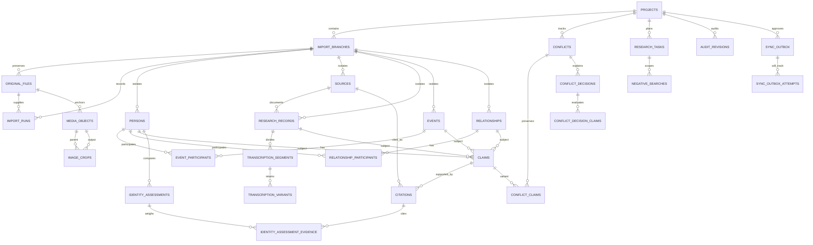

# ETAPA 1: SQLite model Family Tree 2.0

## Stav a hranice

ETAPA 1 přidává volitelnou relační vrstvu vedle stávajícího `research.json`.
Formáty 1 a 2, jejich CLI, exporty a obnova zůstávají beze změny. SQLite není
automatická náhrada existujících soukromých projektů a žádná migrace rodinných
dat se nespouští bez samostatně připraveného a zkontrolovaného mapování.

Implementace je pouze místní. Tabulka `sync_outbox` eviduje budoucí výslovně
schválené operace pro Gramps Web, ale ETAPA 1 neobsahuje odesílací metodu,
síťový klient ani automatické spouštění. Příkazy `database` pracují jen se
soukromým SQLite souborem mimo Git.

## Soubory a migrace

- `migrations/0001_core_evidence_model.sql`: projekty, oddělené importní
  historie, neměnné původní soubory, osoby, prameny, zápisy, segmentové
  přepisy, události, vztahy, tvrzení, citace, totožnost, konflikty, média,
  úkoly a negativní hledání.
- `migrations/0002_audit_outbox_and_immutability.sql`: append-only audit,
  idempotentní outbox a databázové ochrany původních variant.
- `scripts/sqlite_store.py`: migrační runner s kontrolními součty, lokální
  modelové API, integritní kontrola a auditní hashový řetězec.
- `scripts/family_tree.py database init|migrate|status|check`: stabilní CLI
  vstup bez zásahu do dosavadních příkazů.

Každá aplikovaná migrace je zapsána v `schema_migrations` včetně SHA-256 a
současně v `PRAGMA user_version`. Pozměněný migrační soubor nebo nesouvislá
historie jsou odmítnuty. Migrace běží v jedné transakci a downgrade není
automaticky podporován.

## Základní invarianta

- `research_records.reading_status = reviewed` znamená vizuálně zkontrolované
  čtení. `identity_assessments.status = supported` je jiné, samostatné
  rozhodnutí s citovanými podklady a zdůvodněním.
- `birth`, `baptism`, `death` a `burial` jsou čtyři různé hodnoty
  `events.event_type`, nikoli zaměnitelné popisky.
- `persons`, `relationships` a `events` jsou kontejnery. Pravdivost hodnoty
  nebo vazby vyjadřuje až explicitní řádek `claims`.
- Tvrzení začíná jako `unverified`. Přechod na `supported` nebo `rejected`
  vyžaduje citaci, neprázdné zdůvodnění, stupeň důkazu a čas posouzení.
- Posouzení totožnosti začíná jako `unresolved`. Závěr vyžaduje citované
  evidence; každá položka je zvlášť označena `support` nebo `counter`.
- Text tvrzení, citace, původní soubor, varianta přepisu, konfliktová varianta,
  konfliktové rozhodnutí, obrazový původ, audit a negativní hledání se
  nepřepisují. Nový názor se přidává jako nová varianta nebo rozhodnutí.
- Každá importní historie má vlastní `import_branches` a idempotency klíče jsou
  jedinečné uvnitř větve. Cizí klíče brání připojení importované entity k jiné
  větvi. Projektový konflikt může záměrně porovnat tvrzení z více větví, ale
  původní tvrzení neslučuje.
- Outbox má jedinečný `(project_id, idempotency_key)`, hash kanonického JSON
  payloadu, schvalující osobu a čas. Řádky jsou v ETAPĚ 1 neměnné a neodesílají
  se.

## ERD



Polymorfní subjekt tvrzení je ve skutečném schématu vyjádřen čtyřmi
volitelnými cizími klíči a `CHECK`, který povolí právě jeden z nich. ERD jej pro
čitelnost kreslí jako čtyři možné vazby.

## Místní použití

```sh
python3 skills/family-tree-chatgpt/scripts/family_tree.py \
  database init /soukrome-uloziste/family-tree-2.sqlite
python3 skills/family-tree-chatgpt/scripts/family_tree.py \
  database check /soukrome-uloziste/family-tree-2.sqlite
python3 skills/family-tree-chatgpt/scripts/family_tree.py \
  database status /soukrome-uloziste/family-tree-2.sqlite
```

`sqlite_store.GenealogyStore` je transakční API pro vědomé mapování. Metody
zahrnují projekty a větve, původní soubory a importní běhy, osoby, prameny,
zápisy, přepisové varianty, události, vztahy, tvrzení a citace, posouzení
totožnosti, konflikty, obrazový původ, úkoly, negativní hledání, audit a outbox.
Importér má nejprve zavolat `start_import_run`; návrat `created=False` znamená,
že stejný idempotentní import už byl zaznamenán a jeho entity se nemají vložit
znovu.

## Neautomatická migrace větví A a B

Tento postup není spuštěn implementací ETAPY 1. Nejdřív se provede na kopii v
soukromém úložišti a výsledek se porovná s původními archivy.

### 1. Vstupní kontrola a záloha

1. Původní archivy otevřít pouze ke čtení; nevkládat je do Git repozitáře.
2. Vytvořit nový SQLite soubor a před každou importní větví pořídit konzistentní
   SQLite backup. Aktivní databázi nekopírovat prostým kopírováním souboru;
   použít SQLite backup API nebo `VACUUM INTO`.
3. Ověřit SHA-256 dostupných vstupů. Větev A smí pokračovat jen s archivem
   `099959713c8acf8420c570236eac0f52b692b4a9608d01b2d94fcd90ce78ca1e`.
   Větev B smí pokračovat jen se ZIP
   `79ffdb589a6ec31322112fbed38f01bf688b79392cdf24241bedb66479bdcd38`.
4. Archiv B je nyní znám jen umístěním v ChatGPT Library
   `/Genealogie rodu Hrachovinovych/FamilyTree/`. Dokud není místně a oprávněně
   dostupný a jeho hash nesouhlasí, import B se zastaví. Obsah se neodvozuje z
   počtů ani z paměti.

### 2. Oddělení historií

V jednom projektu založit dvě různé větve:

| Větev | `branch_key` | Druh | Známá metadata, nikoli obsah |
|---|---|---|---|
| A | `revision_13_a` | `json_v2` | 3 zápisy, 15 osob, 15 vztahů, 94 tvrzení, 6 pramenů, 94 citací |
| B | `revision_13_b` | `json_v1` | 12 badatelských záznamů, 15 sources, 10 crops |

Každý archiv se zapíše do `original_files` své větve s SHA-256 a úplným
`provenance_json`. Každý import má jiný `import_runs.id` a idempotency klíč ve
tvaru `sha256:<hash>:mapper-v1`. Označení „revize 13“ se uloží jako zdrojová
revize, nikdy jako důvod ke sloučení.

### 3. Mapování A

1. Rozbalit do nové dočasné složky a spustit stávající `project check` nad
   kopií. Při chybě mapování nezačínat.
2. V jediné databázové transakci založit importní běh ve větvi A a mapovat
   `records`, `persons`, `relationships`, `claims`, `sources` a `citations`.
3. Osoba a vztah zůstávají kontejnery. Stav tvrzení se převezme jen tehdy, když
   původní tvrzení splní stejné citační a zdůvodňovací podmínky; jinak zůstane
   `unverified` a odchylka se zapíše do auditního payloadu.
4. Datum narození nevytváří křest a datum úmrtí nevytváří pohřeb. Události se
   mapují pouze podle skutečně explicitního typu vstupu.
5. Před `COMMIT` porovnat počty 3/15/15/94/6/94, cizí klíče, stav konfliktů a
   audit. Neshoda provede `ROLLBACK` celé větve.

### 4. Mapování B

1. Po místním získání ZIP ověřit přesný hash, obnovit jej do nové izolované
   složky a zkontrolovat formát 1 bez jeho přepsání.
2. V samostatné transakci a větvi B mapovat pouze skutečně přítomných 12
   badatelských záznamů, 15 pramenů a 10 výřezů včetně jejich původu.
3. Formát 1 se nesmí automaticky doplnit osobami, vztahy ani tvrzeními. Tyto
   entity vzniknou jen pozdějším vědomým badatelským rozhodnutím.
4. Před `COMMIT` porovnat počty 12/15/10, SHA-256 všech dostupných médií,
   souřadnice a rodiče výřezů a cizí klíče. Neshoda provede `ROLLBACK` B a
   nijak nemění A.

### 5. Konflikty K01–K13

Konflikty se zakládají jako projektové objekty až z doloženého seznamu jejich
konkrétních tvrzení. Metadata-only fixture potvrzuje pouze počet a označení
K01–K13; neobsahuje jejich věcný obsah. Není proto dovoleno vytvářet domnělé
vazby. Rozhodnutí přidá `conflict_decisions` a dispozice variant, ale původní
`claims` a `conflict_claims` zůstávají.

### 6. Validace a obnova

Po každé větvi spustit `database check`, uložit `database status`, porovnat
očekávané počty a vytvořit novou konzistentní zálohu. Zkontrolovat zejména:

- `PRAGMA integrity_check` a `foreign_key_check` bez chyb;
- správný SHA-256 migrací, vstupů a outbox payloadů;
- žádné entity A v `branch_id` B a naopak;
- původní konfliktní varianty stále přítomné;
- souvislý auditní hashový řetězec;
- prázdný outbox, pokud nebyla jednotlivá operace výslovně schválena.

Před `COMMIT` je rollback obyčejný databázový `ROLLBACK`. Po commitu se
neměnné řádky nemažou: nevyhovující pracovní databáze se odloží jako auditní
artefakt a obnoví se poslední ověřená SQLite záloha do nového souboru. Původní
archivy A/B zůstávají nedotčené a jsou konečným obnovovacím bodem.

## Acceptance kritéria ETAPY 1

- [x] Schéma vzniká skutečnými verzovanými SQL migracemi z prázdné databáze.
- [x] Migrace 1 → 2 zachová existující řádky a kontroluje SHA-256 migrací.
- [x] Stávající JSON formáty a CLI zůstávají funkční a nezměněné.
- [x] Větve A/B mají samostatné historie, původní soubory a idempotency klíče.
- [x] `reviewed` není svázáno s `supported`; čtyři klíčové typy událostí jsou
  rozlišeny a kontejnery osoby/vztahu samy nic nedokazují.
- [x] Podporovaná a zamítnutá tvrzení i závěry totožnosti vyžadují citovanou
  oporu a zdůvodnění.
- [x] Přepisové varianty user/ChatGPT/Gemini, pozitivní podklady i protidůkazy,
  konflikty a jejich rozhodnutí se uchovávají bez přepisování původních řádků.
- [x] Obrazový původ, výřezy, úkoly a negativní hledání mají integritní vazby.
- [x] Audit je append-only, hashově zřetězený a kontrolovatelný.
- [x] Outbox je idempotentní, vyžaduje schválení a ETAPA 1 jej neodesílá.
- [x] Automatické testy používají syntetická data; fixture A/B je výslovně
  metadata-only a neobsahuje rodinná data ani domnělý obsah archivů.

## GO / NO-GO pro ETAPU 2

**GO pro vývoj ETAPY 2 nad novou SQLite vrstvou**, zejména pro explicitní
mapovací adaptéry, dry-run reporty a uživatelské schvalování outboxu.

**NO-GO pro produkční import větví A/B a pro jakýkoli zápis do Gramps**, dokud
nejsou splněny všechny následující podmínky: archiv B je místně dostupný a jeho
SHA-256 ověřený; vznikne zkontrolované mapování skutečného obsahu obou archivů;
K01–K13 budou napojeny na konkrétní původní tvrzení; proběhne dry-run s
počty, integritou a obnovou; uživatel výslovně schválí případnou produkční akci.

Otevřená rizika:

1. obsah archivu B nyní není místně ověřený;
2. skutečné mapování A ani B nebylo součástí ETAPY 1, pouze model a bezpečný
   neautomatický postup;
3. znám je počet K01–K13, ne jejich úplný strojově mapovatelný obsah;
4. SQLite předpokládá jednoho zapisujícího procesu; souběh je serializován
   `BEGIN IMMEDIATE`, ale distribuovaná koordinace není navržena;
5. outbox nemá odesílač ani vzdálené potvrzení — záměrně až v další etapě;
6. commit `01aaa16…` deklaruje VERSION 0.5.0, ale v Git historii chybí tag
   `v0.5.0`; vydání proto nesmí odvozovat verzi pouze z `git describe`.
